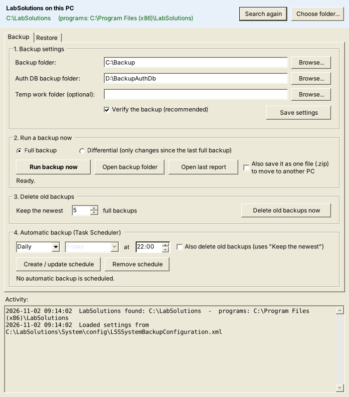
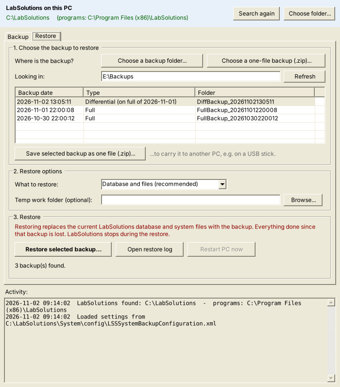

# LabSolutions Backup Tool

A small, portable Windows program for the **System Backup / System Restore** function of Shimadzu LabSolutions.
It replaces hand-editing XML files in Notepad and setting up Task Scheduler by hand.

> Not made by, or affiliated with, Shimadzu Corporation. LabSolutions is a trademark of Shimadzu Corporation.
> Use at your own risk, and test a restore on a non-production system first.

## Download and run

1. Download `LabSolutionsBackupTool.exe` from the [latest release](https://github.com/Swamp82/labsolutions-backup-tool/releases/latest).
2. Copy it to the LabSolutions PC (a USB stick is fine). There is nothing to install.
3. Double-click it and allow administrator rights.

It needs .NET Framework 4.5 or newer, which is part of Windows 10 and 11.
Windows SmartScreen may warn that the program is unsigned: click **More info → Run anyway**.

## What it does

| Backup | Restore |
|---|---|
|  |  |

*(Screenshots from a preview build; on Windows the window uses the normal Windows look.)*

**Finds LabSolutions by itself**
- Looks in the usual places (`C:\LabSolutions`, `C:\Program Files (x86)\LabSolutions` on every drive),
  the `LSSService` registration and the LabSolutions installer entries in the registry.
- If it is not there, it searches all local drives. You can also point to the folder with **Choose folder...**.
- The found location is remembered in `C:\ProgramData\LabSolutionsBackupTool\locations.txt`.


**Backup tab**
- Reads and edits `C:\LabSolutions\System\config\LSSSystemBackupConfiguration.xml`
  (backup folder, authentication DB backup folder, temp work folder, verify).
  A dated copy of the old file is kept next to it on every change.
- Creates missing folders, offers to replace mapped drives (e.g. `M:`) with their `\\server\share` path
  (mapped drives are usually not visible to elevated or scheduled programs), and warns about low disk
  space or backups on the system drive.
- Runs a full (`LSSSystemBackup.exe`) or differential (`LSSSystemBackup_diff.bat`) backup and checks
  the report and log files it creates.
- Deletes old backups, keeping the newest N `FullBackup_<date>` folders.
- Creates the Task Scheduler job (daily or weekly, run whether user is logged on or not, highest privileges).
  If the schedule also cleans up old backups or runs a differential backup, the tool copies itself to
  `C:\ProgramData\LabSolutionsBackupTool\` so the schedule works without the USB stick.

**One-file backups (moving to another PC)**
- Tick "Also save it as one file (.zip)" on the Backup tab, or pick any backup on the Restore tab and click
  "Save selected backup as one file (.zip)" (for example straight to a USB stick). A differential backup is
  saved together with its full backup.
- On the new PC, on the Restore tab, click "Choose a one-file backup (.zip)...". The tool unpacks it to
  `C:\ProgramData\LabSolutionsBackupTool\Restore\` (or another local drive if C is short of space) and selects it in the list.
- LabSolutions must already be installed on the new PC, with its database created in the same folder as on the old PC.

**Restore tab**
- **Choose a backup folder...** (a `FullBackup_<date>` folder, or a folder containing them, on any drive,
  USB stick or network share) or **Choose a one-file backup (.zip)...**.
- Lists the full and differential backups found there, newest first.
- Writes `RestorePath`, `RestoreMode` and `WorkFolder` to
  `C:\LabSolutions\System\config\LSSSystemRestoreConfiguration.xml` (with a dated copy of the old file).
- Stops `LSSService`, runs `LSSSystemRestore.exe` (you answer its questions in its own window),
  checks for the restore log, and offers to restart the PC. If the restore is cancelled, it offers to
  start `LSSService` again.

The tool's own log is `C:\ProgramData\LabSolutionsBackupTool\LabSolutionsBackupTool.log`.

## Command line

Used by the scheduled task:

```
LabSolutionsBackupTool.exe --unattended [--keep N] [--diff]
```

Old backups are only deleted after a backup that finished cleanly.

## Build

Single C# file, no project needed.

Windows (the compiler ships with .NET Framework):

```
C:\Windows\Microsoft.NET\Framework64\v4.0.30319\csc.exe /target:winexe /optimize+ /out:LabSolutionsBackupTool.exe /r:System.Windows.Forms.dll /r:System.Drawing.dll /r:System.Xml.dll /r:System.Core.dll /r:System.ServiceProcess.dll /r:System.IO.Compression.dll /r:System.IO.Compression.FileSystem.dll src\LabSolutionsBackupTool.cs
```

Linux/macOS with Mono:

```
mcs -target:winexe -sdk:4.5 -optimize+ -out:LabSolutionsBackupTool.exe -r:System.Windows.Forms.dll -r:System.Drawing.dll -r:System.Xml.dll -r:System.Core.dll -r:System.ServiceProcess.dll -r:System.IO.Compression.dll -r:System.IO.Compression.FileSystem.dll src/LabSolutionsBackupTool.cs
```

## License

MIT - see [LICENSE](LICENSE).
